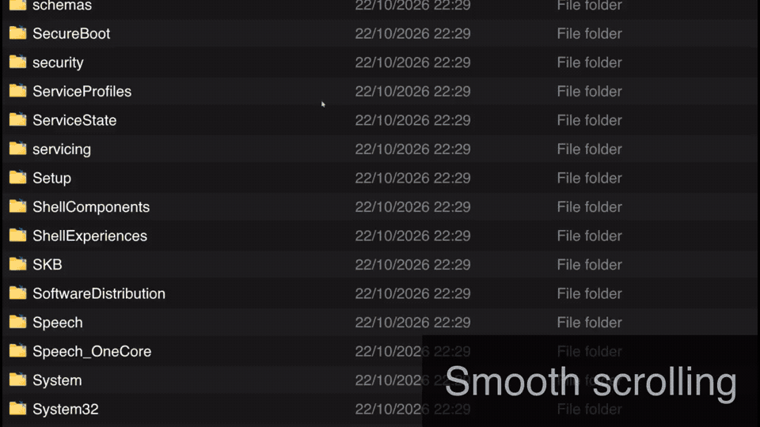

# GPU-accelerated list and grid views for `explorer.exe`

A Windhawk mod for Windows 11 Explorer with GPU rendering for smooth animations and modern look.

- Replicates explorer views using hardware accelerated graphics: Details list and icons grid, including thumbnails, sorting and grouping.
- Animated interactions: grouping, sorting, selecting/cutting/copying files, and many more.
- Smooth scrolling, touchscreen and touchpad gestures.
- RTL language support.
- Optional button to switch back to native Explorer view; **Ctrl+Alt+F9** also works when the button is hidden.
- Prioritizes responsiveness and animations over efficiency.
- Less likely to break in future Windows updates since it does not modify the default views of explorer but recreates them

## Features
- **Adjustable Item Height** — Smooth zooming with Ctrl+mouse wheel or pinch gestures.
- **Custom Fonts** — Personalize the appearance with your preferred fonts.
- **Animated Selection & Hover States** — Smooth visual transitions, including a dedicated selection style for file names only.
- **Smooth Scrolling** — Fluid scrolling for a more responsive browsing experience.
- **Touch support** — Multi touch support with modern interactions.
- **Seamless View Switching** — You can easily switch between the modded and native views directly from the Explorer window.
- **Detailed Tooltips** — Under **Mouse hover**, includes available file properties such as dimensions, bitrate, comments and tags.

## Touch gestures
- Swipe horizontally with one finger to start marquee selection. 
- Two finger horizontal swipes will start Back or Forward gestures (disabled by default). 
- Pinch to resize, tap to select, and double-tap to open. 
- For context menu: press and hold, or tap with two fingers. 
- To drag files: press and hold an item, then move your finger. Lift to drop.
- The scrollbars remain large and easy to drag (even if they appear small, their trigger area remains comfortably large)

## Report bugs
Report bugs in the mod's main repository [Here](https://github.com/DarkionAvey/windhawk-gpu-accelerated-explorer-view/issues). 
Enable **Enable logging** when reproducing a bug and include Windhawk's log in the report. Note: logs include file names and paths; scramble the file names before submitting the logs if you wish.

