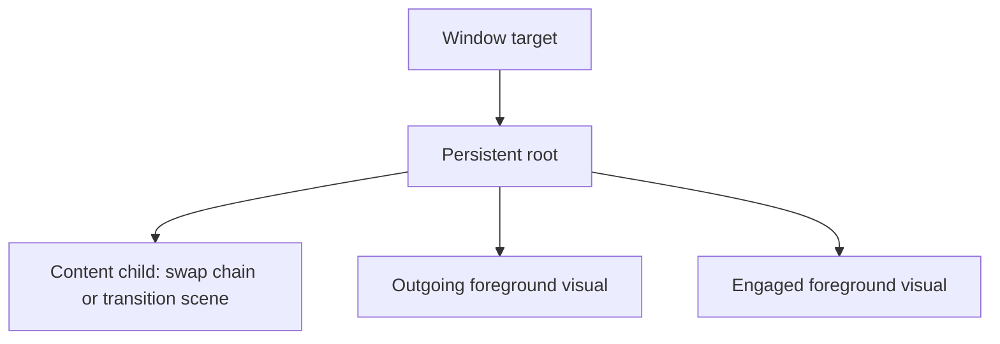

# Foreground rendering isolation (0.9.295–0.9.296)

The 14:15 log contains 23,031 retained pipeline records and 13,569 reported
drops. It records several decreasing opacity submissions during a later scroll
change, but submission telemetry does not establish what reached the display.
The report that the problem also occurs without logging rules out treating the
0.9.294 logging change as the solution to this rendering issue.

## Remaining dependencies in 0.9.294

The input and render threads had separate foreground revisions, but the
content-model assignment still copied all foreground fields. Its backup was
restored only for a strictly newer revision. Thus an equal-revision content
snapshot could overwrite renderer-owned progress with input-side progress.

The bubble was also rasterized into either the file-list swap chain or a
temporary transition scene's chrome bitmap. File-list preparation, paint,
presentation and scene-root replacement therefore controlled those pixels.
Separate threads and successful `Present` records did not remove that coupling.

## Rendering changes

The presentation target now retains a stable root:

Content replacement changes the bottom child. The foreground surfaces, effects
and animation objects remain attached above it. They use the existing per-tab
render owner, shared gesture geometry, cached palette and composition-surface
publication path. Surface storage grows from the actual sampled geometry and
is included in memory diagnostics. Actual viewport/DPI changes adapt geometry
without restarting a committed opacity curve.

Foreground input snapshots are copied separately from content fields and are
accepted only when their intent revision increases. Ordinary label, metadata,
scroll and layout models cannot replay or clear the renderer's current intent.

A successful release freezes the shape and attaches a native 80 ms opacity
animation. It uses DirectComposition's default first-displayed-frame origin;
an application-side deadline cannot expire an intent before its first
foreground submission. After submission the compositor samples that curve
without requiring renderer or UI-thread frames. CPU retirement leaves the
native curve attached through its terminal zero value. See Microsoft's
[animation overview](https://learn.microsoft.com/en-us/windows/win32/directcomp/animation)
and [begin-time semantics](https://learn.microsoft.com/en-us/windows/win32/api/dcompanimation/nf-dcompanimation-idcompositionanimation-setabsolutebegintime).

Foreground-only pulses reuse accepted file-list pixels. UI-owned metadata
queue flags no longer keep the render owner repainting while no new model has
arrived; actual renderer work, ready model changes and content animations still
request paints. New foreground intents are published before content preparation.
Tracking and cancellation springs keep their shared geometry and frame pacer.
This does not move incoming touch recognition off Explorer's owner thread or
make all existing UI effects compositor-owned.

A real tab/window hide clears both foreground surfaces and the render intent,
while preserving its revision. Resuming from an unchanged input snapshot
cannot replay an old gesture. Device loss, fallback, standby recycling and DLL
unload use the existing graphics/lifetime paths; content root changes preserve
native-host suppression and the accepted-image handoff.

## Verification

Native Ninput tests retain their actual Windows recognizer boundary. New
checks deliver late label updates, parent-item scrolling and Details/icon
changes through the real presentation mailbox, checking that the native
foreground visual and curve identities remain unchanged. Pending-name cases
also verify that foreground animation does not repaint accepted list content.
A nonactivating native minimize/restore case checks stale-intent retirement.

The component pixel helper explicitly flattens the independently rendered
foreground surfaces using sampled expected opacity. It checks geometry and
blending at 96/192 DPI in LTR/RTL; it does not measure actual DWM scanout.
Native curve/visual ownership is checked separately. Both full release gates
passed. The final 0.9.296 gate includes the native menu, rendering, regression
and DLL-unload suites. Live Explorer smoothness on the slower PC remains a
separate visual check.
