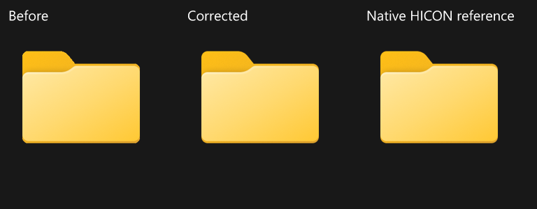

# Shell icon transparency (0.9.240)

The supplied comparison shows bright fringes and jagged-looking edges around
the overlay's folder icon. A private empty-folder probe reproduced the same
appearance without using the user's folders, clipboard or focus.

## Cause and correction

`LoadShellItemIcon` imported image-factory HBITMAPs with
`WICBitmapUsePremultipliedAlpha`. The tested Windows image factory returns
straight BGRA for both folder icons and transparent PNG thumbnails. Labeling
those bytes premultiplied lets faint edge pixels retain full-strength colors
when Direct2D blends them, producing the conspicuous bright outlines.

The 256-pixel folder image had 137 pixels whose RGB exceeded their alpha, with
an excess as large as 239. The independently decoded native HICON had none.
Importing the factory bitmap with `WICBitmapUseAlpha` and using the existing WIC
conversion to PBGRA made the result byte-identical to that native HICON.
The same correction fixes transparent thumbnails: a half-transparent red PNG
was previously passed to the GPU with red=255 and alpha=128.

The fix changes the factory import's alpha interpretation. The HICON decoder,
image requests, dimensions, GPU filters, zoom and 0.9.239 readiness/backpressure
optimizations remain unchanged. Conversion still happens once on the existing
tab-owned image lane; there is no extra per-frame pass or texture.

Microsoft documents the [WIC alpha options](https://learn.microsoft.com/en-us/windows/win32/api/wincodec/ne-wincodec-wicbitmapalphachanneloption)
and the distinction between [straight and premultiplied pixel formats](https://learn.microsoft.com/en-us/windows/win32/wic/-wic-codec-native-pixel-formats).
The factory's actual pixel interpretation here is established by the native
reference and transparent-image probes, rather than inferred from its handle.

## Verification

`tests/icon-alpha-smoke.h` uses a private empty folder and generated transparent
PNG. It checks factory decoding against independently acquired native HICON
pixels, including antialiased edges and shadows. The PNG is compared with its
WIC-decoded reference to detect both missing and double premultiplication.
GPU readback compares dark/white backgrounds, LTR/RTL, Cut opacity, and icon
sizes from 24 through 256 physical pixels. Unchanged 0.9.239 fails the new test
with `RGB exceeds alpha`; the working 0.9.240 passes.

The optional `GPU_OVERLAY_ICON_ALPHA_PREVIEW` output shows the old interpretation,
the corrected loader and the native HICON source, using identical geometry and
GPU filtering. It is an offscreen component comparison, not a live Explorer
screenshot or frame-rate measurement. Folder thumbnail artwork itself is a
separate feature from this alpha correction.

`build.bat -SourceFile 0.9.240.cpp` passed the complete release gate, including
Windhawk DLL linking, repository/C++/graphics/input/attachment suites and 21
actual DLL unloads. The native-alpha checks passed in the full run as well as
the focused run. The large-tile tests remain successful.

Published `latest.cpp`, the Windhawk export and archived `0.9.240.cpp` share
SHA256 `04C9DC919E2EF57CD3E9668941686F8EB2099FF6DC2132BA7EC53F3CF5190B76`.
All 43 prior archives match `tests/archive-hashes-before-240.json`.
`IconInterpolation`, `PresentationFrameReady`, `DrawCachedIcon`, `UpdateMetrics`,
`AdvanceRowHeight` and `ApplyRowHeight` are byte-identical to 0.9.239.
