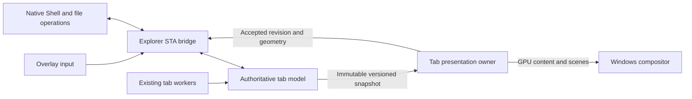

# Independent overlay presentation

The overlay now has three ownership boundaries within each tab. Explorer's
STA owns the Shell bridge and the authoritative tab model. A dedicated
presentation thread owns all D3D, D2D, DXGI, DirectComposition and raster
resources. The existing tab workers continue to enumerate names and resolve
optional metadata and images independently.

## Snapshot and acknowledgement contract

`PresentationModel` is an explicit whitelist of visual data. No Shell
interfaces, native selection transactions or provider state are copied into
the presentation state. Its HWND values identify the composition target and
paint exclusions; the presenter does not acquire window ownership or query
Explorer's STA for geometry, fonts, focus or current items.

The existing names worker publishes an immutable complete directory model
once per names result. Frame packets share that model and add bounded sparse
viewport/destination metadata, selection pages and immutable icon pixels.
Selection uses copy-on-write 1 KiB pages; clipboard paths and pixel buffers
also share immutable storage until changed. Frames do not copy the complete
directory, entire selection or thumbnail byte arrays. Collapsed and moving
groups have a shared immutable intent map so offscreen group geometry remains
correct. Full group indexing and reconstruction run on the presentation lane.

Each tab has one latest pending packet and one latest receipt. Obsolete
unconsumed packets are reclaimed on the existing tab retirement lane. The
presentation worker uses the existing shared geometry, Paint, animation and
cache functions; native-only continuations are excluded from that state.
The compositor pulse signals active lanes without drawing under its shared
registry lock. Each lane advances its own scroll, zoom, row/column, group,
selection, hover, clipboard and scrollbar presentation while Explorer is
inside a native call or is not dispatching messages.

Receipts carry lifetime, native-view and directory tokens, source animation
origins, accepted model revision and current geometry. The bridge accepts
matching receipts before handling subsequent messages. A late receipt cannot
replace a newer selection, directory or animation intent. Completed zooms
update input geometry; settled animations release bridge frame wakes.
Column intent and its actual compositor start clock are acknowledged
separately, so adopting a successfully committed clock does not look like a
new transition or restart an existing scene.
Visibility-only completion has its own revision check: a names refresh can
advance while hidden without discarding standby completion, and an unstarted
cold image does not become a device-failure state. Reshowing a cached image
resumes its lane even when Windows needs no immediate WM_PAINT.
Filesystem `tree.present` timing is recorded at actual accepted rendering on
the presentation lane and acknowledged back to the bridge.

Before committing native selection or invoking a native file command, the
bridge publishes its completed logical model. Names deliveries also publish
before later native work. This lets visual feedback start without waiting for
the native call to return. File operations continue to use the existing
verified native identities and reconciliation/failsafe paths.

## Resource lifetime

The renderer is a normal tab-owned `TabBackground` lane. Its MTA contains no
Explorer-owned COM interfaces. Tabs do not serialize one another's rendering
or providers. Per-tab image residency uses an adaptive budget and incremental
LRU retirement rather than scanning the complete cache on each frame.

Hidden tabs settle through the existing warm-image path. The accepted image,
swap chain, device, visible glyphs and icon resources survive normal tab
switching. Temporary composition scenes and obsolete textures are retired
using the existing completion and memory-pressure rules. Closing a tab
signals cancellation without waiting on Explorer's UI thread. The lifetime
regulator drains workers before DLL unloading, including the renderer and
composition pulse; exceptions also retire the presentation registry/resources.
Worker failure notifications carry the overlay lifetime so a retired worker
cannot disable a subsequently created window. Discarded full names snapshots
are reclaimed outside UI callbacks and outside the producer queue lock.
The frame pulse also checks cancellation before its outer infinite wait.
Otherwise its short cadence wait can consume the auto-reset stop signal and
leave teardown waiting forever. The regression forces that precise ordering.

## Limits

This separates overlay presentation and GPU preparation from Explorer's UI
dispatch. Explorer still owns its frame, address/navigation controls, native
dialogs and file operations. The overlay's HWND/input delivery and Shell
command bridge remain on Explorer's STA. New input or native model events can
therefore arrive late while that STA is blocked. Already-admitted visual
transitions continue on their presentation/compositor owners. No synchronous
render-thread-to-STA calls, guessed completion timers or forced provider-thread
termination are used to hide that limitation.

## Validation

`tests/presentation-owner-smoke.h` uses private windows, synthetic models and
substituted focus. Its owner intentionally does not dispatch messages while
the real presentation lanes render. It covers blocked renderer startup in one
tab while another progresses, latest-only coalescing, immutable 30,000-item
models and selection/image/clipboard storage, consistent visible revisions,
independent scrolling and grid zoom, stale acknowledgements, synchronized
input geometry, and warm hide/resume.

Delete/restore, concurrent scrolling and column movement finish with an
unpumped owner in all eight LTR/RTL Details/grid and grouped combinations.
An offscreen group collapse verifies complete document geometry and its
bridge acknowledgement. Twenty actual presentation owners retain private 4K
tab images, become idle in standby, preserve resources over repeated returns,
and release devices and GPU memory on close. The actual DLL teardown fixture
also starts a presentation worker and disables its overlay with queued motion
before the host verifies DLL unmapping.

Cold hiding before the first GPU image, resuming without a paint, names
revalidation after hiding, adopted compositor clocks and stale worker-failure
notifications have explicit checks. The frame-stop probe forces cancellation
between DWM completion and the short cadence wait, including safe diagnostic
recovery if that contract regresses.

These are component, resource and compositor-contract checks. They establish
thread independence and submission behavior, not live Explorer input latency,
displayed frame rate or monitor scan-out. Results and the full release gate
are recorded in CHANGELOG.md and `tests/build-0.9.217.log`.
